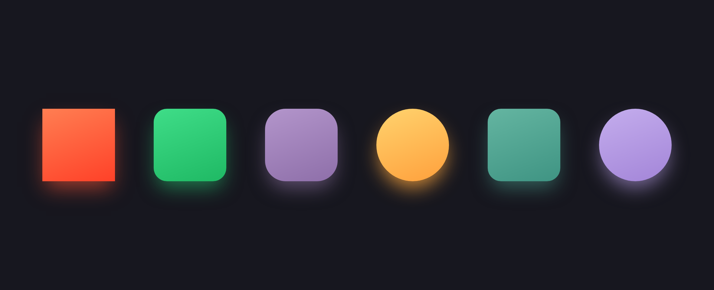
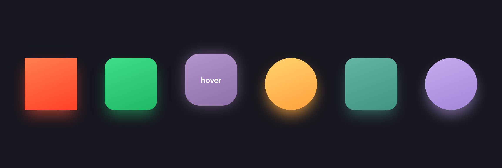

# CSS 形状悬停效果

学习通作业：纯 HTML + CSS 实现一排形状的悬停交互效果。

## 效果预览

| 默认状态 | 鼠标滑过（悬停） |
| :---: | :---: |
|  |  |

## 效果说明

- **默认状态**：每个形状下方带有与自身颜色一致的彩色光晕（阴影向下偏移）。
- **鼠标滑过**：
  1. 形状位置上移 **10px**；
  2. 阴影偏移量变为 **0**（光晕由"下方投影"变为"四周均匀包裹"）；
  3. 形状中间出现 **"hover"** 字样。

## 关键实现

- 上移 10px：`.shape:hover { transform: translateY(-10px); }`
- 阴影偏移归零：默认 `box-shadow: 0 16px 32px -6px var(--glow)`，悬停时改为 `box-shadow: 0 0 32px var(--glow)`
- 显示 "hover"：`.shape::after { content: "hover"; opacity: 0; }`，悬停时 `opacity: 1`
- 形状按「圆角类 + 颜色类」组合复用样式：
  - 圆角：`square` / `rounded-sm` / `rounded-lg` / `circle`
  - 颜色：`coral` / `emerald` / `orchid` / `amber` / `teal` / `lavender`
- 每个颜色类通过 `--glow` 变量保存光晕颜色，供 `box-shadow` 使用；
  `transition` 让位置、阴影、文字的变化平滑过渡。

## 使用

用浏览器直接打开 `index.html`，鼠标滑过任意形状即可看到效果。
